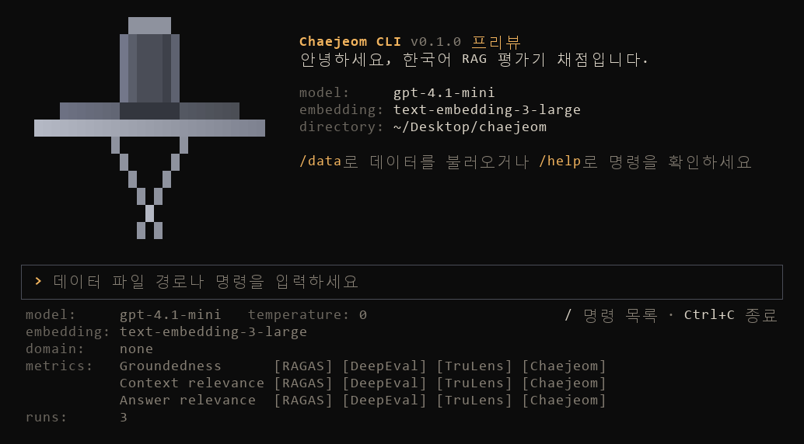

<div align="center">

# 채점 (Chaejeom)

**한국어 RAG를 위한 레퍼런스 프리 평가 도구**

[](LICENSE)
[](pyproject.toml)
[](#현재-상태)

[문서](docs/README.ko.md) | [English](README.md)

</div>

채점은 검색 증강 생성(RAG) 시스템을 한국어 데이터로 평가합니다.
[RAGAS](https://github.com/vibrantlabsai/ragas), [DeepEval](https://github.com/confident-ai/deepeval),
[TruLens](https://github.com/truera/trulens)의 레퍼런스 프리 LLM-as-a-Judge 지표를 한국어에 맞게 다시 구성해 한
도구에 모았고, 정해진 규칙으로 점수를 매기며 서비스의 도메인을 반영할 수 있는 채점만의 지표 세 개를 더했습니다.
질문, 검색된 문맥, 답변만 있으면 됩니다.

<p align="center">
  
</p>

## 특징

- **한국어 기준으로 준비.** 프롬프트와 예시를 한국어로 새로 쓰고, 답변은 한국어 형태소 분석기로 문장을 나누며,
  판정 설명도 일관된 한국어로 받습니다.
- **세 프레임워크, 하나의 형식.** 원본 지표 9개를 데이터 하나, 설정 파일 하나, 결과 파일 하나로 돌리고, 같은 세
  축 위에 나란히 보여 줍니다.
- **원본에 충실한 이식.** 프롬프트, 절차, 척도, 집계, 예외 처리를 고정한 커밋의 원본 코드대로 따릅니다. 바꾼
  부분은 모두 지표 소스 파일에 적었습니다.
- **규칙으로 매기는 채점 지표.** 판정 모델은 진술, 문맥 조각, 답변을 표시만 하고, 다섯 단계 점수는 코드가
  정합니다. 근거로 든 인용문은 검색된 문맥에 실제로 있는지 확인합니다.
- **도메인에 맞춘 판정 (실험 기능).** 무엇을 같은 대상으로 볼지처럼 도메인에서 판정이 어떻게 달라야 하는지
  설명하면, 채점이 그 기준을 세 판정 프롬프트에 글자 그대로 넣습니다. 지표의 정의, 출력 형식, 점수 규칙은 그대로이고
  도메인 정보가 정답을 알려 주지는 않습니다. 현재 테스트하며 고도화하고 있는 기능입니다.
- **반복 개선에 맞춤.** 여러 번 돌려 평균과 표준편차로 보여 주고, 실행 전 예상 비용, 응답 캐시, 판정마다 남는
  이유, 실행끼리 비교하는 `chaejeom compare`를 제공합니다.

## 설치

Python 3.10 이상이 필요합니다. 아직 PyPI에 배포하지 않았으므로 소스에서 설치합니다.

```bash
git clone https://github.com/9cheol2/chaejeom.git
cd chaejeom
pip install -e .
```

[uv](https://docs.astral.sh/uv/)를 쓴다면 `uv sync`로 설치하고 `uv run chaejeom`으로 실행합니다.

## 빠른 시작

**1. OpenAI API 키 설정.** 실행할 폴더의 `.env` 파일에 넣습니다([.env.example](.env.example) 참고).

```bash
OPENAI_API_KEY=sk-...
```

**2. 데이터 준비.** JSONL 형식으로 한 줄에 샘플 하나씩 씁니다.

```jsonl
{"query": "연차휴가는 입사 첫해에 며칠 쓸 수 있나요?", "contexts": ["입사 후 1년 미만인 경우 1개월 개근 시 1일의 유급휴가가 발생한다.", "입사 첫해에 발생하는 유급휴가는 최대 11일이다."], "answer": "한 달 개근할 때마다 하루씩, 최대 11일까지 쓸 수 있습니다."}
```

CSV와 RAGAS, DeepEval용으로 만든 데이터도 그대로 쓸 수 있습니다. [데이터 형식](docs/data-format.ko.md)을 보세요.
데이터 파일은 `input/` 폴더에 두세요. [input/basic.csv](input/basic.csv)에는 일반 샘플 10개가,
[input/finance.csv](input/finance.csv)에는 도메인 파일 [domains/finance.yaml](domains/finance.yaml)과 함께 쓰는 금융
샘플 8개가 있습니다.

**3. 평가 실행.** 대화형 터미널을 열고 파일을 불러온 뒤 `/run`을 입력합니다. 평가할 횟수와 예상 비용을 보여 주고,
Enter를 누르면 시작합니다.

```bash
chaejeom
```

```
> examples/samples.jsonl
> /run
```

설정 파일로 한 번에 실행할 수도 있습니다.

```bash
chaejeom run --config examples/eval.yaml --data examples/samples.jsonl
```

```
결과 (샘플 평균, 3회 반복의 평균 ± 표준편차)

                           RAGAS      DeepEval       TruLens      Chaejeom       Average
 ───────────────────────────────────────────────────────────────────────────────────────
 Groundedness        0.36 ± 0.00   1.00 ± 0.00   0.39 ± 0.00   0.55 ± 0.00   0.58 ± 0.00
 Context relevance   0.92 ± 0.00   0.61 ± 0.00   0.68 ± 0.04   0.79 ± 0.00   0.73 ± 0.01
 Answer relevance    0.58 ± 0.00   0.61 ± 0.00   0.67 ± 0.00   0.64 ± 0.02   0.62 ± 0.00
```

결과는 `output/` 폴더에 `<데이터 파일 이름>_<날짜-시각>` 이름으로 저장됩니다. `.json`에는 모든 판정과 그 이유가,
`.csv`에는 샘플당 한 행씩 점수가 들어 있습니다. 결과표의 축 이름과 머리글은 결과 파일의 키와 맞추기 위해 화면
언어와 상관없이 영어로 나옵니다.

### Python

```python
from chaejeom import EvalSample, evaluate

samples = [
    EvalSample(
        query="재택근무는 일주일에 며칠까지 가능한가요?",
        contexts=["재택근무는 주 2일까지 신청할 수 있으며, 팀장 승인이 필요하다."],
        answer="재택근무는 팀장 승인을 받아 주 2일까지 할 수 있습니다.",
    )
]

result = evaluate(samples, preset="all")
print(result.by_axis)
result.to_json("result.json")
```

모든 옵션은 [Python API](docs/python-api.ko.md)를 보세요.

## 지표

| 축 (보는 입력) | RAGAS | DeepEval | TruLens | 채점 |
|---|---|---|---|---|
| **근거성**<br>문맥, 답변 | Faithfulness | Faithfulness | Groundedness | Groundedness |
| **문맥 관련성**<br>질문, 문맥 | ContextRelevance | ContextualRelevancy | Context Relevance | Context Relevance |
| **답변 관련성**<br>질문, 답변 | ResponseRelevancy | AnswerRelevancy | Answer Relevance | Answer Relevance |

같은 축도 프레임워크마다 판정 방식이 다릅니다. RAGAS는 뒷받침되는 진술의 비율을 세고, DeepEval은 주장마다
모순을 찾고, TruLens는 문장과 문맥 조각에 0점에서 3점을 매깁니다. 채점 지표는 읽을 수 있는 규칙으로 다섯 단계
점수를 매깁니다. 각 지표와 고르는 법은 [지표](docs/metrics.ko.md)를 보세요.

## 문서

| 문서 | 내용 |
|---|---|
| [지표](docs/metrics.ko.md) | 지표 12개, 채점 지표의 점수 규칙, 도메인 정보 파일, 지표 고르기, 점수 읽는 법 |
| [명령줄](docs/cli.ko.md) | `chaejeom run`, `compare`, `list`, 대화형 모드의 모든 명령 |
| [설정](docs/configuration.ko.md) | 설정 파일, 모델, 지표 옵션, 캐시, 도메인 정보 파일과 프롬프트 파일, 데이터 흐름 |
| [데이터 형식](docs/data-format.ko.md) | 입력 필드, CSV, 다른 프레임워크의 필드 이름, 형식 오류 |
| [결과](docs/results.ko.md) | 결과 JSON과 CSV, 판정 단위, 반복 실행 통계, 비용 |
| [Python API](docs/python-api.ko.md) | `evaluate`, `aevaluate`, 샘플, 결과 |
| [용어 대역표](docs/glossary.md) | 영어 프롬프트 용어를 한국어로 옮긴 기준 |

## 현재 상태

채점은 개발 중이며 아직 정식 배포 전입니다. 평가 모델과 임베딩 모델은 지금 OpenAI API만 지원합니다.

앞으로 할 일:

- **지원 모델 확장.** Anthropic, Google, Ollama, Hugging Face의 LLM, SLM, 임베딩 모델
- **평가 도구 확장.** 다른 레퍼런스 프리 평가 프레임워크를 같은 세 축으로 추가
- **채점 지표 고도화.** 판정 기준 다듬기, 도메인 기준 평가 기능의 테스트와 개선

## 원본 버전

| 프레임워크 | 라이선스 | 버전 | 커밋 |
|---|---|---|---|
| [RAGAS](https://github.com/vibrantlabsai/ragas) | Apache-2.0 | v0.4.3 | [`4ecab38`](https://github.com/vibrantlabsai/ragas/tree/4ecab384fda829ca50bec3f07cc49589d756e172) |
| [DeepEval](https://github.com/confident-ai/deepeval) | Apache-2.0 | 4.3.1 | [`29dcf5f`](https://github.com/confident-ai/deepeval/tree/29dcf5f24397715a60348c1e41e7d416a3b2d6c8) |
| [TruLens](https://github.com/truera/trulens) | MIT | 2.16.0 | [`1f65a31`](https://github.com/truera/trulens/tree/1f65a310cd5bdaef3ea7be76e98022f574cea39c) |

원본 프레임워크 지표는 원본 방법론을 바탕으로 한 한국어 구현입니다. 원본과 같은 점수를 보장하지 않으며, 점수는
평가 모델에 따라 달라집니다.

## 참고 자료

- Es et al. [Ragas: Automated Evaluation of Retrieval Augmented Generation](https://arxiv.org/abs/2309.15217).
  EACL 2024 System Demonstrations.
- Zheng et al. [Judging LLM-as-a-Judge with MT-Bench and Chatbot Arena](https://arxiv.org/abs/2306.05685).
  NeurIPS 2023 Datasets and Benchmarks Track.
- Liu et al. [G-Eval: NLG Evaluation using GPT-4 with Better Human Alignment](https://arxiv.org/abs/2303.16634).
  EMNLP 2023.
- Lee et al. [CheckEval: A reliable LLM-as-a-Judge framework for evaluating text generation using
  checklists](https://arxiv.org/abs/2403.18771). EMNLP 2025. 채점 지표가 이 방식을 따릅니다. 판정 모델은 확인할 수
  있는 항목에 답하고, 점수는 정해진 규칙이 매깁니다.
- [Kiwi (kiwipiepy)](https://github.com/bab2min/kiwipiepy). 답변을 문장으로 나누는 데 쓰는 한국어 형태소
  분석기입니다.

## 라이선스

채점은 [Apache License 2.0](LICENSE)으로 배포합니다. RAGAS, DeepEval, TruLens의 코드를 참고해 재구성했으며, 출처는
[THIRD_PARTY_NOTICES.md](THIRD_PARTY_NOTICES.md)에 적었습니다. 채점은 독립 프로젝트이며 RAGAS, DeepEval, TruLens
프로젝트와 제휴하거나 그들의 보증을 받은 것이 아닙니다.
