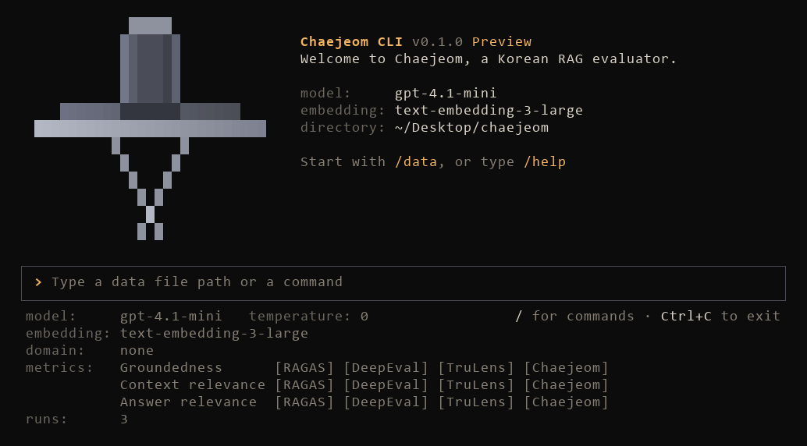

<div align="center">

# Chaejeom (채점)

**Reference-free evaluation for Korean RAG**

[](LICENSE)
[](pyproject.toml)
[](#project-status)

[Documentation](docs/README.md) | [한국어](README.ko.md)

</div>

Chaejeom evaluates retrieval-augmented generation (RAG) systems on Korean data. It brings the reference-free
LLM-as-a-judge metrics of [RAGAS](https://github.com/vibrantlabsai/ragas),
[DeepEval](https://github.com/confident-ai/deepeval) and [TruLens](https://github.com/truera/trulens) into one
toolkit, rebuilt for Korean, and adds three metrics of its own that score with fixed rules and can take your domain
into account. All you need is the query, the retrieved contexts and the answer.

<p align="center">
  
</p>

## Highlights

- **Built for Korean.** Prompts and few-shot examples are rewritten in Korean, answers are split into sentences with
  a Korean morphological analyzer, and judge explanations come back in consistent Korean.
- **Three frameworks, one format.** Nine upstream metrics share one dataset, one config file and one result file,
  and are reported side by side on the same three axes.
- **Faithful ports.** Prompts, procedures, scales, aggregation and edge cases follow the upstream code at a pinned
  commit. Every deviation is documented in the metric's source file.
- **Rule-based Chaejeom metrics.** The judge only marks statements, chunks and answers; code turns the marks into one
  of five levels, and quoted evidence is checked against the retrieved contexts.
- **Domain-aware (experimental).** Describe how judging differs in your domain, such as which targets count as the
  same, and Chaejeom adds your rules word for word to its three judge prompts. Metric definitions, output format and
  scoring rules stay fixed, and the domain never supplies answers. This feature is still being tested and refined.
- **Made for iteration.** Repeated runs reported as mean and standard deviation, a cost estimate before every run,
  response caching, a reason for every verdict, and `chaejeom compare` between runs.

## Installation

Chaejeom requires Python 3.10 or later. It is not on PyPI yet; install it from source:

```bash
git clone https://github.com/9cheol2/chaejeom.git
cd chaejeom
pip install -e .
```

With [uv](https://docs.astral.sh/uv/), run `uv sync` instead and start the CLI with `uv run chaejeom`.

## Quickstart

**1. Set your OpenAI API key** in a `.env` file in your working directory (see [.env.example](.env.example)):

```bash
OPENAI_API_KEY=sk-...
```

**2. Prepare your data**, one sample per line in JSONL:

```jsonl
{"query": "연차휴가는 입사 첫해에 며칠 쓸 수 있나요?", "contexts": ["입사 후 1년 미만인 경우 1개월 개근 시 1일의 유급휴가가 발생한다.", "입사 첫해에 발생하는 유급휴가는 최대 11일이다."], "answer": "한 달 개근할 때마다 하루씩, 최대 11일까지 쓸 수 있습니다."}
```

CSV and datasets prepared for RAGAS or DeepEval work as well; see [Data format](docs/data-format.md). Keep your data
files in `input/`. [input/basic.csv](input/basic.csv) has ten general samples, and
[input/finance.csv](input/finance.csv) has eight financial samples to use with the domain file
[domains/finance.yaml](domains/finance.yaml).

**3. Run an evaluation.** Start the interactive terminal, load the file and type `/run`. Chaejeom shows the number of
evaluations and the estimated cost, and starts when you press Enter.

```bash
chaejeom
```

```
> examples/samples.jsonl
> /run
```

Or run once from a config file:

```bash
chaejeom run --config examples/eval.yaml --data examples/samples.jsonl
```

```
Results (mean over samples, mean ± std over 3 runs)

                           RAGAS      DeepEval       TruLens      Chaejeom       Average
 ───────────────────────────────────────────────────────────────────────────────────────
 Groundedness        0.36 ± 0.00   1.00 ± 0.00   0.39 ± 0.00   0.55 ± 0.00   0.58 ± 0.00
 Context relevance   0.92 ± 0.00   0.61 ± 0.00   0.68 ± 0.04   0.79 ± 0.00   0.73 ± 0.01
 Answer relevance    0.58 ± 0.00   0.61 ± 0.00   0.67 ± 0.00   0.64 ± 0.02   0.62 ± 0.00
```

Results are saved in `output/` as `<data file name>_<date-time>`: the `.json` file keeps every verdict with its reason,
and the `.csv` file has one row per sample for spreadsheets. Axis names and headers in the result table are always in
English so that they match the keys in the result file.

### Python

```python
from chaejeom import EvalSample, evaluate

samples = [
    EvalSample(
        query="재택근무는 일주일에 며칠까지 가능한가요?",
        contexts=["재택근무는 주 2일까지 신청할 수 있으며, 팀장 승인이 필요하다."],
        answer="재택근무는 팀장 승인을 받아 주 2일까지 할 수 있습니다.",
    )
]

result = evaluate(samples, preset="all")
print(result.by_axis)
result.to_json("result.json")
```

See the [Python API](docs/python-api.md) for every option.

## Metrics

| Axis (inputs) | RAGAS | DeepEval | TruLens | Chaejeom |
|---|---|---|---|---|
| **Groundedness**<br>context, answer | Faithfulness | Faithfulness | Groundedness | Groundedness |
| **Context relevance**<br>query, context | ContextRelevance | ContextualRelevancy | Context Relevance | Context Relevance |
| **Answer relevance**<br>query, answer | ResponseRelevancy | AnswerRelevancy | Answer Relevance | Answer Relevance |

The frameworks judge each axis differently: RAGAS counts supported statements, DeepEval looks for contradictions
claim by claim, and TruLens grades sentences and chunks on a scale of 0 to 3. The Chaejeom metrics score on five
levels from rules you can read. [Metrics](docs/metrics.md) explains each one and how to choose.

## Documentation

| Guide | Contents |
|---|---|
| [Metrics](docs/metrics.md) | The 12 metrics, the Chaejeom scoring rules, domain files, choosing metrics, reading scores |
| [Command line](docs/cli.md) | `chaejeom run`, `compare`, `list`, and every interactive command |
| [Configuration](docs/configuration.md) | Config file, models, metric options, caching, domain and prompt files, data flow |
| [Data format](docs/data-format.md) | Input fields, CSV, field names from other frameworks, format errors |
| [Results](docs/results.md) | Result JSON and CSV, per-verdict units, repeated-run statistics, cost |
| [Python API](docs/python-api.md) | `evaluate`, `aevaluate`, samples, results |
| [Glossary](docs/glossary.md) | How English prompt terms are translated into Korean |

## Project status

Chaejeom is under active development and has not been released yet. The judge and embedding models currently run on
the OpenAI API only.

Planned work:

- **More model providers.** LLMs, small language models and embedding models from Anthropic, Google, Ollama and
  Hugging Face.
- **More frameworks.** Other reference-free evaluation frameworks, reported on the same three axes.
- **Better Chaejeom metrics.** Refined judging rules, and further testing of domain-aware judging.

## Upstream versions

| Framework | License | Version | Commit |
|---|---|---|---|
| [RAGAS](https://github.com/vibrantlabsai/ragas) | Apache-2.0 | v0.4.3 | [`4ecab38`](https://github.com/vibrantlabsai/ragas/tree/4ecab384fda829ca50bec3f07cc49589d756e172) |
| [DeepEval](https://github.com/confident-ai/deepeval) | Apache-2.0 | 4.3.1 | [`29dcf5f`](https://github.com/confident-ai/deepeval/tree/29dcf5f24397715a60348c1e41e7d416a3b2d6c8) |
| [TruLens](https://github.com/truera/trulens) | MIT | 2.16.0 | [`1f65a31`](https://github.com/truera/trulens/tree/1f65a310cd5bdaef3ea7be76e98022f574cea39c) |

Each upstream metric is a Korean implementation of the original method. Scores are not guaranteed to match the
originals and depend on the judge model.

## References

- Es et al. [Ragas: Automated Evaluation of Retrieval Augmented Generation](https://arxiv.org/abs/2309.15217).
  EACL 2024 System Demonstrations.
- Zheng et al. [Judging LLM-as-a-Judge with MT-Bench and Chatbot Arena](https://arxiv.org/abs/2306.05685).
  NeurIPS 2023 Datasets and Benchmarks Track.
- Liu et al. [G-Eval: NLG Evaluation using GPT-4 with Better Human Alignment](https://arxiv.org/abs/2303.16634).
  EMNLP 2023.
- Lee et al. [CheckEval: A reliable LLM-as-a-Judge framework for evaluating text generation using
  checklists](https://arxiv.org/abs/2403.18771). EMNLP 2025. The Chaejeom metrics follow its approach: the judge
  answers checkable items, and fixed rules turn the answers into a score.
- [Kiwi (kiwipiepy)](https://github.com/bab2min/kiwipiepy), the Korean morphological analyzer used to split answers
  into sentences.

## License

Chaejeom is licensed under the [Apache License 2.0](LICENSE). It adapts code from RAGAS, DeepEval and TruLens; see
[THIRD_PARTY_NOTICES.md](THIRD_PARTY_NOTICES.md). Chaejeom is an independent project and is not affiliated with or
endorsed by the RAGAS, DeepEval or TruLens projects.
